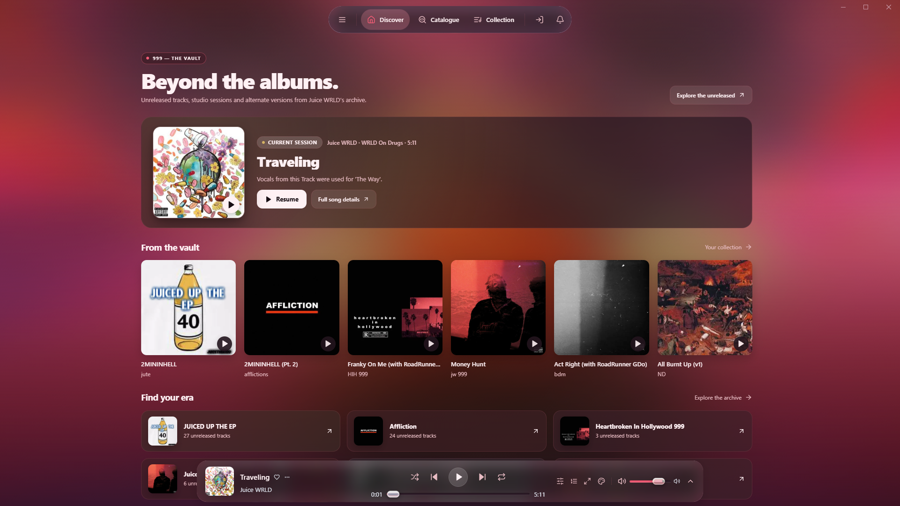
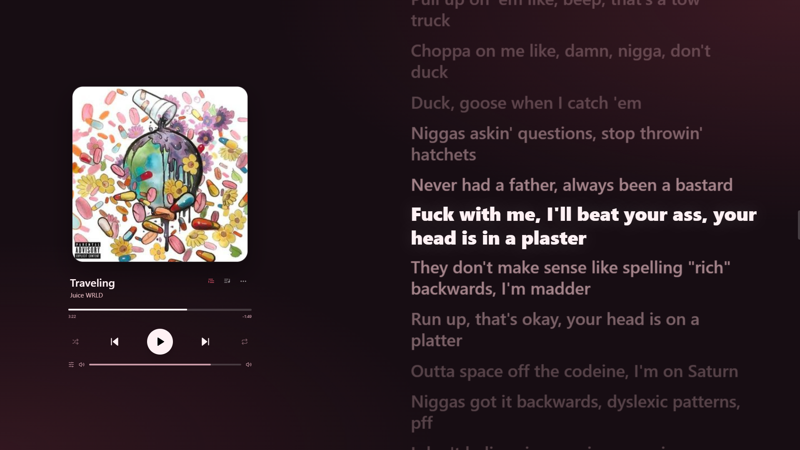

# Unreleased Glass

A desktop music player for exploring Juice WRLD's released and unreleased catalogue, organizing your music and listening with fullscreen lyrics.

Built from [Unreleased](https://github.com/Juice-WRLD-API/Unreleased), with a cover-led interface, glass controls and a simpler everyday layout.



## What you can do

- **Discover more music.** Explore Juice WRLD's eras, unreleased tracks, studio recordings and alternate versions through their cover art.
- **Find the version you want.** Search the catalogue, compare versions and open a song's credits, notes and related footage.
- **Keep your music together.** Use playlists, liked songs, albums and local files, with offline downloads for listening without a connection.
- **Listen with lyrics.** Open WRLD for fullscreen artwork and synchronized lyrics. Choose a lyric presentation or hide the controls for a cleaner listening screen.
- **Tune in to 999 FM.** Listen to the live station and join its chat. Resuming the radio brings you back to the live broadcast.
- **Choose your look.** Switch between Light, Dark and album themes. You can also let the app's colors follow the playing cover, or use Game & economy mode for a calmer background.

Catalogue information and available audio come from the [Juice WRLD API](https://juicewrldapi.com). Some catalogue entries have information but no playable audio.

## What's different in Glass?

Discover, Catalogue and Collection put everyday listening first: larger covers, eras in chronological order, direct playback and fewer technical controls on screen. The original app's advanced tools remain available through Developer options.

Footage shows a real frame from each video, loaded as you scroll, with a plain "View song" action when a video clearly belongs to a catalogue song. Every list can be expanded, so the whole archive is reachable.

The interface adds translucent glass controls and cover-inspired backgrounds. WRLD brings artwork and lyrics into one listening view, with clear ways to return to your music or change the atmosphere.

## Windows installation

Open [Releases](https://github.com/GoodFight37/Unreleased/releases), download the Windows installer and run it. Then open **Unreleased Glass** from the Start menu.

Installed versions check this repository for updates. Glass uses its own profile and keeps the original Unreleased installation separate. Before the first launch, close the original player so Glass can import its preferences. Imported offline files are copied, which can require extra disk space.




## For developers

The active branch is `app`. This is an Electron + React desktop fork; the API is maintained by the original project.

The custom WebGPU glass renderer and WebGL2 background remain in place. Upstream changes through v2.6.51 are adapted to this interface, including Windows taskbar playback controls, lyrics-job notifications and optional synchronized music videos. The upstream SVG glass effect is a fallback when WebGPU glass is unavailable. Music videos default to Off.

With Node.js 22 and npm:

```bash
npm ci
npm run build
npm run electron:dev
```

For a local Windows installer:

```bash
npm run electron:build -- --win --publish never
```

Build output goes to `release/`. Releases are deliberate; a push to `app` does not publish an installer.

See [release instructions](docs/RELEASING.md), [validation results and known limits](docs/VALIDATION.md) and [the agent guide](AGENTS.md) for architecture and checks. The [WRLD sharing proposal](docs/WRLD-STORIES.md) describes future work and is not a shipped feature.

## Credits and license

The original player, API and catalogue are the work of the Unreleased team. This fork keeps the [MIT license](LICENSE), copyright leanwrldd. Bundled third-party licenses are listed in [THIRD-PARTY-NOTICES.md](THIRD-PARTY-NOTICES.md).
