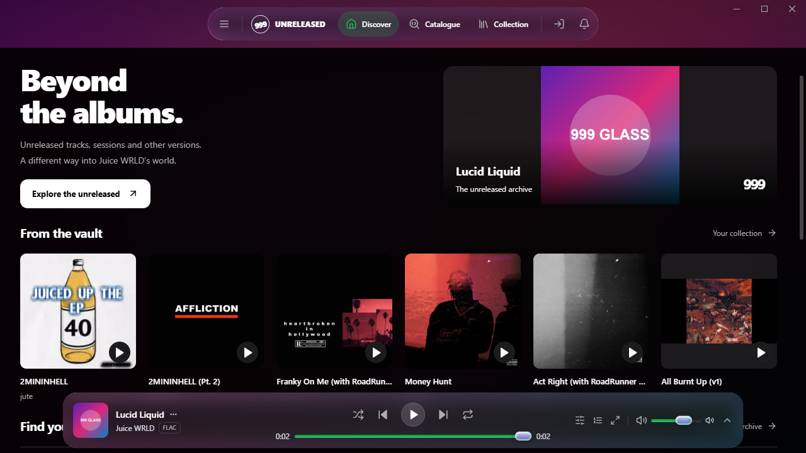
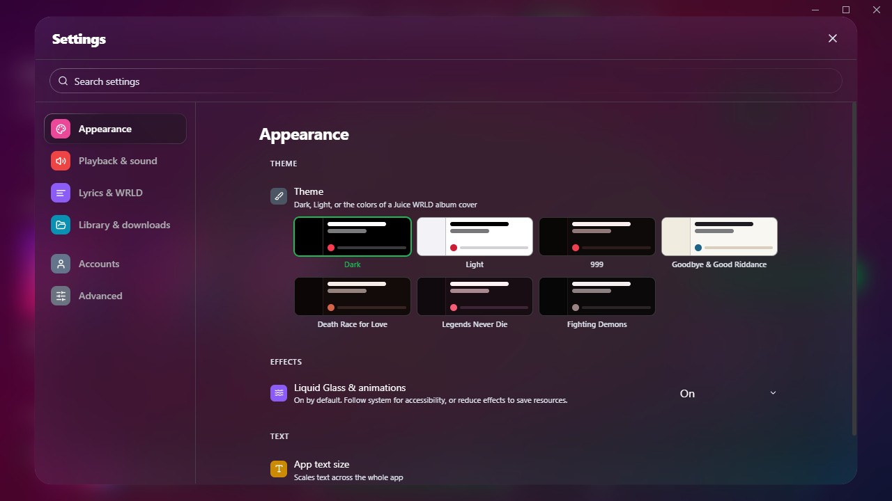
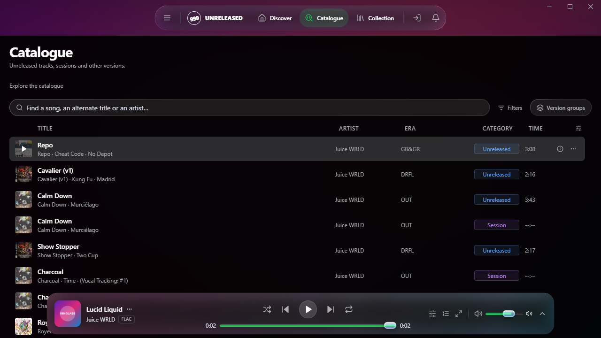

# Unreleased Glass

An alternative look for **[Unreleased](https://github.com/Juice-WRLD-API/Unreleased)**,
the desktop player for Juice WRLD's unreleased catalogue built on the
[Juice WRLD API](https://juicewrldapi.com).

Same player, same catalogue, same accounts and community features, with a
different layout built around the music: fewer controls, larger covers,
"liquid glass" on floating controls and themes drawn from the albums.
It isn't meant to replace the original app; both can run side by side.

All credit for the player, the API and the catalogue goes to the Unreleased
team. For the full feature list, see the
[original README](https://github.com/Juice-WRLD-API/Unreleased#readme).



Screenshots use a local verification track in the player; catalogue titles
and cover artwork come from the API.

---

## What's different

**Look**
- **Liquid glass on what floats.** The top bar, the player, menus and dialogs
  are drawn as real-time glass (WebGPU), with a CSS fallback. Pages
  themselves stay flat and crisp, so lists and text read easily.
- **Album themes.** Next to Dark and Light: 999, Goodbye & Good Riddance,
  Death Race for Love, Legends Never Die and Fighting Demons. Their colours
  are taken from the covers, and each one uses its own cover as the
  backdrop behind the window. Every theme is checked for readable contrast
  (WCAG AA).
- **Calmer motion.** Short, quiet transitions (mostly 150 to 250 ms), nothing
  on keyboard shortcuts, and "reduce motion" respected everywhere.
- **WRLD screen.** The blurred cover behind the now-playing view drifts very
  slowly.


**Layout**
- **Three main destinations:** Discover, Catalogue and Collection. Playlists,
  liked songs and albums sit together inside Collection.
- **A cover-led home:** resume listening, find unreleased tracks and browse
  Juice WRLD's eras through their artwork and playable song counts.
- **A quieter Catalogue:** search and filters stay close; sections and named
  version groups open when needed. Detailed layout controls stay in Developer mode.
- **One animated menu** for settings, shortcuts, community features and
  creative tools, without repeating settings across several menus.
- **Simple settings in six pages:** theme, effects, audio output, equalizer,
  lyrics, music folders, downloads and accounts. Technical controls and detailed
  customization remain available through Developer mode. Settings always open
  large inside the main window.
- **Start with Windows** for installed Windows builds; source builds explain
  why that switch is unavailable.
- **Audio quality tag** next to the artist in the player (for example
  `FLAC 24/96`, `MP3 320`).
- **Command palette** (`Ctrl+K`) to jump to any page, tool or theme.
- **Share Studio**: export lyrics as a PNG or an MP4 with audio, in 9:16,
  16:9 and other formats.





**Under the hood**
- Its own app ID and data folder, so it installs and runs next to the
  original Unreleased app without touching it.
- Updates from the original project are not applied automatically.
- Extra checks in the main process (IPC sender checks, safer file and
  download paths).

---

## Running it

There are no packaged builds of this fork yet; it runs from source. If you
just want the original app, get it from the
[Unreleased releases](https://github.com/Juice-WRLD-API/Unreleased/releases/latest).

You need **Node.js 22** and npm.

```bash
npm install
npm run electron:dev
```

This starts Vite on port `3018` and opens Electron against it with hot
reload. Copy `.env.local.example` to `.env.local` if you need local settings
(every value is optional).

## Scripts

| Command | What it does |
|---|---|
| `npm run electron:dev` | Vite and Electron in dev mode |
| `npm run build` | Typecheck and build the renderer into `dist/` |
| `npm run electron:build` | Build and package an installer into `release/` |
| `npm run typecheck:electron` | Typecheck the main process |
| `npm run test:electron` | Main-process unit tests |
| `npm run test:scripts` | Renderer helper tests (themes contrast, eras, audio tag…) |
| `npm run ui:verify` | Launches the built app and checks layout, contrast and frame rate, with screenshots in `.ui-verify/` |
| `npm run ui:motion` | Records every animation the app actually plays, with its duration and easing |

## License

[MIT](LICENSE), copyright leanwrldd, like the original project. Bundled
third-party licences are listed in
[THIRD-PARTY-NOTICES.md](THIRD-PARTY-NOTICES.md).
