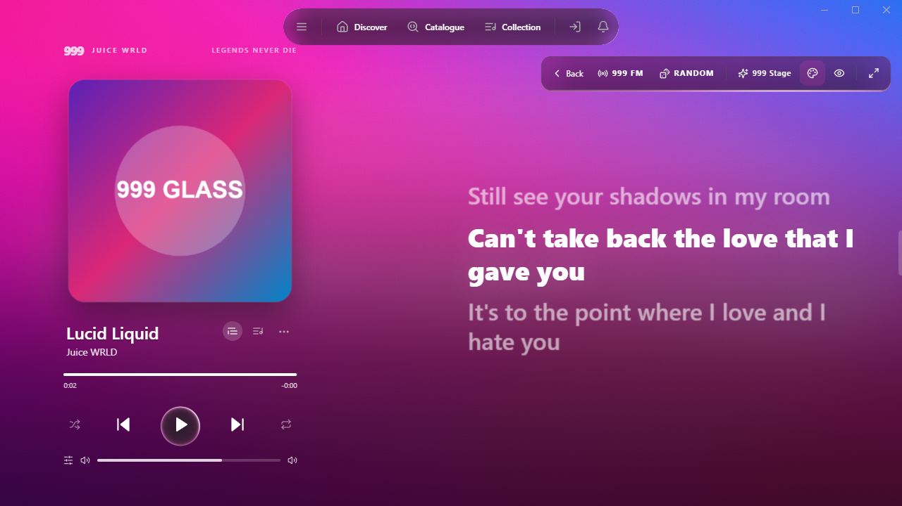
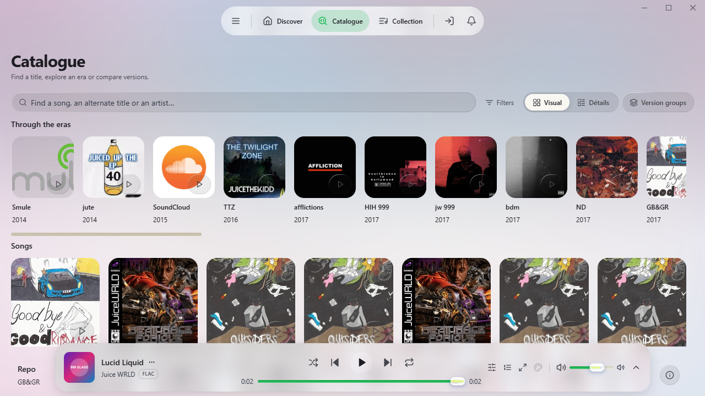

# Unreleased Glass

Desktop client for the Juice WRLD catalogue ([Juice WRLD API](https://juicewrldapi.com)), forked from [Unreleased](https://github.com/Juice-WRLD-API/Unreleased) with a WebGPU Liquid Glass shell and a WebGL2 era backdrop engine.

## Engine & Fan Experience

- **Navigation (fan path).** Three top-level destinations: **Discover**, **Catalogue**, and **Collection** (playlists, liked songs, albums, and local files). Technical tools, tracker tables, diagnostics, and Glass Lab stay behind **Settings → Advanced → Developer options**.
- **WebGPU Liquid Glass compositor.** Floating controls (navigation pill, player bar, segmented toggles, sliders, menus, and dialogs) render over a half-resolution separable blur pass (`ceil(w/2) × ceil(h/2)`, DPR capped at `1.5`), with SDF pill merging (`smin`), pointer-tracked specular highlights, interactive slider loupe, and `onSubmittedWorkDone()` frame backpressure. Readability is maintained by adaptive luminance clamping in `glass.wgsl` rather than opaque dark boxes.
- **WebGL2 Liquid Mesh & era atmospheres.** 64×64 bicubic tensor-product mesh fed by a GPU AMLL hue-preserving tone map and Dual Kawase pyramid (`128→64→32→64→128`). Four era atmosphere profiles (**999**, **GB&GR**, **DRFL**, **LND**) adjust drift speed, subtle grain, color warmth, and audio energy displacement (`u_energy`), with inherited tuning for later eras and 2–3 slow SVG butterflies reserved strictly for *Legends Never Die*.
- **Adaptive cover palette.** Extracts dominant, complementary, and tertiary hues from the playing cover via Electron/CORS-safe blob loading (`fetchImageBlob`), driving UI accents and mesh gradients across Dark, Light, and album themes with one-click toggle and restoration.
- **Kinetic lyrics & Stage.** WRLD pairs the era mesh with a 40/60 stage layout, automatic dark/light contrast calibration across the three fan lyric presentations (*Classic*, *Cinema*, *999*), Clean stage mode (`C`), and **Game & economy mode** / `prefers-reduced-motion`, which halts continuous loops while keeping a static era frame on screen.
- **Catalogue & Footage.** Catalogue opens on a chronological cover showcase (`eraStart`) with 1-click era playback and an optional *Details* table toggle. Song info and context menus surface strict-matched `Footage/`, `Snippets/`, and `Studio Sessions/` video clips (`preload="none"`). No pixel mascot is displayed.








## Windows & Build

Requires Node.js 22 and npm.

```bash
npm install
npm run build
```

Windows installer downloads belong in [Unreleased Glass releases](https://github.com/GoodFight37/Unreleased/releases). Local packaging: `npm run electron:build -- --win --publish never` creates `release/Unreleased Glass-Setup-2.6.50.exe` and `release/win-unpacked/Unreleased Glass.exe`. Installed builds update only from this fork's releases. See [release instructions](docs/RELEASING.md). Verification commands: `npm run typecheck:electron`, `npm run test:scripts`, `npm run test:electron`, `npm run ui:verify`, `npm run ui:motion`, `npm run terminal:check-coverage`.

Glass uses a separate profile. On the first launch, close the original player so Glass can import its preferences safely. Offline files are copied into Glass storage; the original profile and media stay intact. No installer release is published by a push to `app` alone.

See [docs/VALIDATION.md](docs/VALIDATION.md) for the baseline validation notes and [docs/UI_REFERENCES.md](docs/UI_REFERENCES.md) for the UI/motion guidelines.

## License

The original player, API and catalogue are the work of the Unreleased team. This fork keeps the MIT license and copyright leanwrldd (see [LICENSE](LICENSE)) and [THIRD-PARTY-NOTICES.md](THIRD-PARTY-NOTICES.md).
